# Projeto CRUD - Cadastro de Pacientes

## 1. Descrição do projeto

Este projeto foi desenvolvido com o objetivo de implementar as quatro operações básicas de um CRUD (Create, Read, Update e Delete), utilizando Java e um banco de dados SQLite.

A implementação utiliza a biblioteca ORMLite para realizar o mapeamento entre as classes Java e as tabelas do banco de dados.

## 2. Classe escolhida

A classe escolhida para a implementação foi `Paciente`.

Ela representa os dados de um paciente e possui os seguintes atributos:

- `id`: identificador do paciente, gerado automaticamente pelo banco de dados.
- `idade`: idade do paciente.
- `nome`: nome do paciente.
- `CPF`: CPF do paciente.
- `birthday`: data de nascimento.
- `endereco`: endereço do paciente.
- `sexo`: sexo do paciente.

A classe foi mapeada para a tabela `Paciente` no banco de dados por meio das anotações da biblioteca ORMLite.

## 3. Tecnologias utilizadas

- **Linguagem:** Java
- **Ambiente de desenvolvimento:** BlueJ
- **Biblioteca ORM:** ORMLite
- **Banco de dados:** SQLite

## 4. Organização das classes

O projeto possui as seguintes classes principais:

| Classe | Responsabilidade |
|---|---|
| `Paciente` | Representa os dados do paciente e define o mapeamento com a tabela do banco de dados. |
| `PacienteRepository` | Implementa as operações CRUD para cadastrar, consultar, atualizar e excluir pacientes. |
| `Database` | Responsável pela conexão com o banco de dados SQLite. |

## 5. Implementação das operações CRUD

Os testes foram realizados diretamente no BlueJ, utilizando a chamada dos métodos das classes e a inspeção dos objetos.

### 5.1 Create — Cadastro

A operação Create é responsável por cadastrar um novo paciente no banco de dados.

Para isso, foi utilizado o método `create()` da classe `PacienteRepository`.

<!-- Substitua pelo nome da imagem do seu teste de cadastro. -->

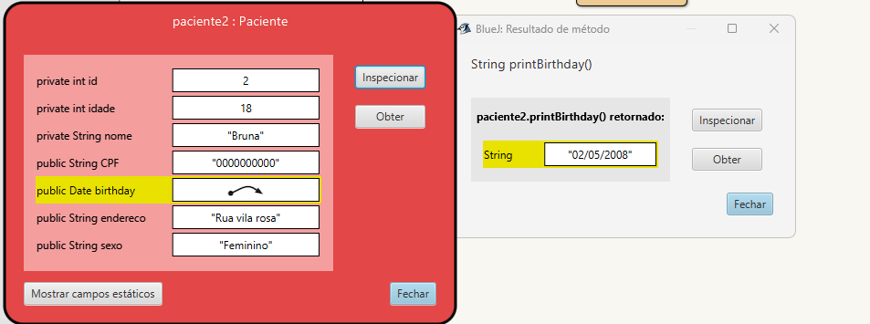 figura1

*Descrição: na figura1 é mostrado a inspeção dos dados presentes no objeto paciente2.*

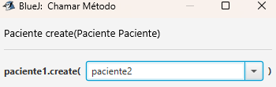 figura2
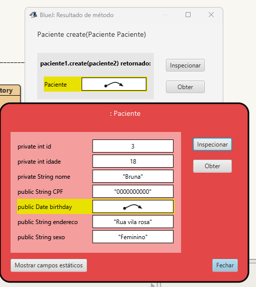 figura3

*Descrição: na figura2 é mostrado que o metodo creat foi chamado para criar o paciente2, e na figura3 pode-se concluir que o objeto foi criado com sucesso apresentando os todos os dados do paciente.*

### 5.2 Read — Consulta

A operação Read permite consultar os pacientes que estão cadastrados no banco de dados.

Foi utilizado o método `loadAll()` para consultar todos os registros.

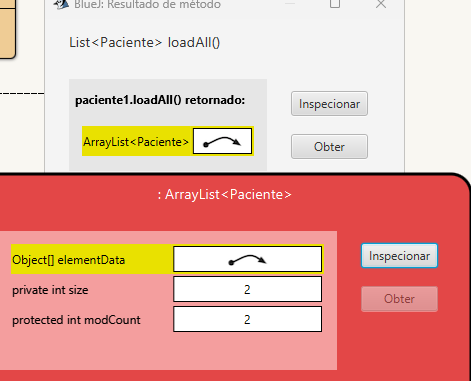 figura4
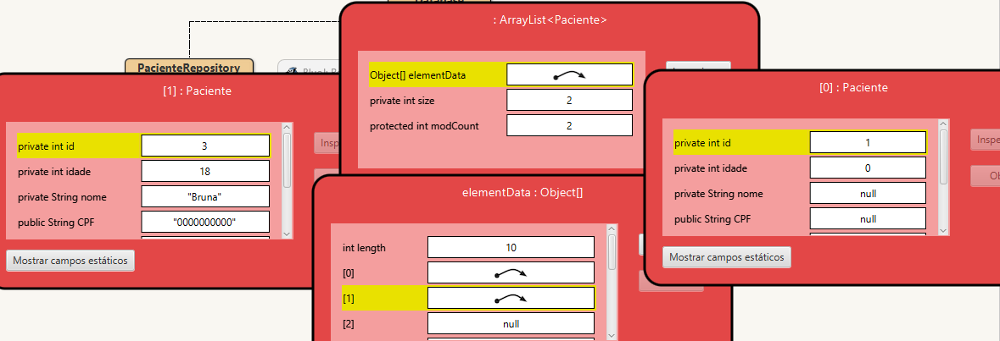 figura5

*Descrição: na figura4 é observado que é possivel consultar os pacientes cadastrados, e na figura5 pode se analisar que além de consultar a quantidade de pacientes também pode-se ler os dados cadastrados desses pacientes.*

### 5.3 Update — Atualização

A operação Update permite modificar os dados de um paciente já cadastrado.

No teste realizado, a idade do paciente foi alterada de 18 para 20 anos. Em seguida, foi utilizado o método `update()` para atualizar o registro no banco de dados.

na figura1, que foi mostrado no Creat, observa-se que nos dados cadastrados a idade corresposnde a 18 anos nas imagens a seguir é mostrado como essa idade foi alterada: 

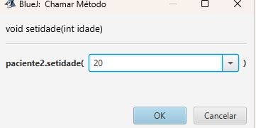figura6

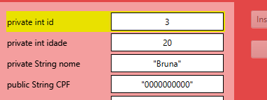figura7

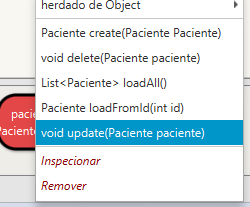figura8

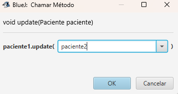 figura9

*Descrição: alteração da idade e chamada do método de atualização.*

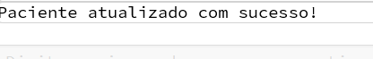 figura10
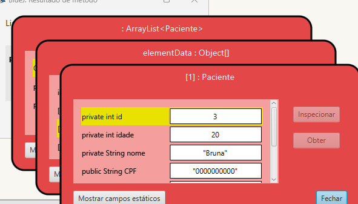 figura11

*Descrição: confirmação da atualização e resultado após a alteração.*

### 5.4 Delete — Exclusão

A operação Delete permite excluir um paciente do banco de dados.

Foi utilizado o método `delete()` da classe `PacienteRepository`.

**Evidência do teste:**

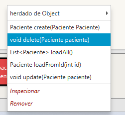 figura12
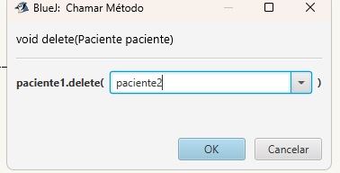 figura13

*Descrição: chamada do método responsável pela exclusão do paciente.*

## 6. Persistência dos dados

Os dados são armazenados no banco de dados SQLite, no arquivo `pacientes.db`.

A persistência permite que os registros permaneçam armazenados no banco mesmo após o encerramento dos testes no BlueJ.

## 7. Como executar o projeto

1. Abra o projeto no BlueJ.
2. Verifique se as bibliotecas necessárias do ORMLite e do SQLite JDBC estão configuradas.
3. Compile as classes do projeto.
4. Crie um objeto `Database`, informando o nome do banco de dados.
5. Crie um objeto `PacienteRepository`, utilizando a conexão com o banco.
6. Utilize os métodos da classe `PacienteRepository` para testar as operações CRUD.

**Observação:** os testes podem ser realizados diretamente pelo BlueJ, sem a necessidade de desenvolver uma interface gráfica.

## 8. Referências

- Tutorial utilizado como referência: https://github.com/marceloakira/tutorials/blob/main/orm/README.md
- Site oficial do ORMLite: https://ormlite.com/
- SQLite: https://www.sqlite.org/

---

**Atividade POO — Persistência de Dados com ORM e CRUD.**

